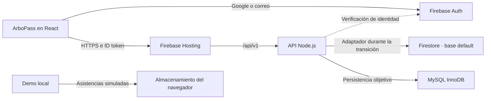

# ArboDex · Diseño del sistema y migración

**Etapa cero · 20 de noviembre de 2026.** ArboDex es un pasaporte de comunidad. Un miembro presenta su QR en un encuentro y un organizador valida la asistencia. El pasaporte reúne doce sellos mensuales y tres especiales por año. La propuesta conserva esa experiencia mientras traslada las reglas de negocio a una API Node.js y los datos operativos a MySQL. Se pidió mantener el registro disponible. El responsable no reporta información que migrar por ahora. La cantidad real de documentos y cuentas sigue sin medirse.

[Lámina para presentar el proyecto](https://www.figma.com/design/WCdsCuLC2w8M7GY0tE9Ge2/?node-id=4-6) · [Sistema de diseño editable](https://www.figma.com/design/WCdsCuLC2w8M7GY0tE9Ge2/?node-id=3-33) · [Prompts y criterios por etapa](../SKILLS.md)

## Qué hay en el repositorio

Se revisaron los archivos rastreados de `ajuste-demo` en `33c9e25`, el árbol de `main` en `011d079` y el historial alcanzable de las ramas clonadas. `development` partía del mismo commit que `main`, 19 commits detrás de `ajuste-demo` y sin commits exclusivos.

| Área | Evidencia | Consecuencia para la migración |
| --- | --- | --- |
| Portal principal | [HTML de entrada](../build/index.html), bundle React de 871 374 bytes, CSS, emblemas y recursos de la colección. El cliente usa Firebase Auth, documentos y transacciones de Firestore. | El árbol contiene el producto compilado. Falta el proyecto TS/JSX, el manifiesto, el lockfile y la configuración de compilación. Reconstruir por flujos con paridad visible. |
| Acceso y actualizaciones | El bundle usa Google y correo, verificación, recuperación, `/?member=<uuid>`, escucha de sellos y de los eventos referidos, y listado de hasta 200 eventos para organizadores. Su pantalla llama a una abstracción `/api/portal` que, en el modo Firebase observado, resuelve un adaptador del navegador. | No existe un servidor Node desplegable en este árbol. Preservar enlaces impresos, propagación de anulaciones y cambios de rol. Distinguir las referencias a la web privada anterior de las rutas que usa el modo Firebase. |
| Demo | [Pantallas](../build/demo/index.html) y [lógica local](../build/demo/app.js) para miembro y organizador, con código de ejemplo, sellos, celebración y reinicio. | Los cambios viven en `localStorage`. Conservar una demo independiente con datos sintéticos. El código corto de ejemplo no identifica las tarjetas reales. |
| Seguridad y modelo | [Reglas](../firestore.rules) para accounts, cards, organizers, events, stamps y stampHistory. [Índices](../firestore.indexes.json) sin índices compuestos declarados. | Las reglas son el contrato de comportamiento inicial. Hay que trasladar sus verificaciones a Node antes de usar un SDK privilegiado. |
| Despliegue | [Configuración](../firebase.json) de Hosting sobre `build/`, reescritura SPA y cabeceras nosniff, política de referencia, DENY y no-cache. [.firebaserc](../.firebaserc) selecciona el proyecto `arbodex`. | El bundle y la configuración apuntan al identificador de base **`default`**. `(default)` es otro identificador. Un cambio de entorno debe comprobar proyecto y base con un registro de prueba conocido. |
| Recursos y mantenimiento | Arte de sellos y pasaporte, Montserrat, sprites remotos y [pie de página](../build/footer-arbodex.js) con enlaces de comunidad y un observador del DOM. El árbol contiene también caché de Hosting y metadatos de macOS. | Inventariar las rutas de imágenes usadas por el portal y por la demo. Restaurar el pie de página como componente React. Desacoplar cachés y archivos generados al recuperar un proceso de build. |
| Pruebas y operación | [PUBLICAR.txt](../PUBLICAR.txt) informa de 40 pruebas en emulador Standard, reglas publicadas y pruebas pendientes sobre Enterprise. El historial disponible carece de fuentes de esas pruebas, CI, migraciones SQL y API. | Son antecedentes del paquete. En esta etapa se comprobó la sintaxis de los tres archivos JavaScript con Node. Las pruebas históricas, el despliegue y las credenciales reales quedan sin verificar. |

**Dos ilustraciones faltantes.** De 20 rutas literales `/demo/` referenciadas por el bundle, dos carecen de archivo en el clon y en el historial disponible. El portal pide `grookey-enero-2026.png` para enero y `zorua-octubre-2026.png` para octubre. El navegador no puede mostrar esas ilustraciones con este paquete. Resolver los originales o aprobar un recurso alternativo y validar los quince sellos en el portal reconstruido.

**Prueba funcional ejecutada.** En Windows se abrió la demo en Chrome con un perfil temporal, servidor de loopback y conexiones externas bloqueadas. Se verificaron los 12 botones mensuales y los 3 especiales, el rechazo de un código desconocido, un check-in GO Fest que dejó intacto el contador mensual, el reintento sin duplicado y la persistencia al recargar. Estas comprobaciones ejercitan el navegador local. La autenticación, los permisos efectivos del proyecto real y la compatibilidad en macOS/Linux quedan para las etapas correspondientes.

**Recuperación del original.** Si aparece el código, compararlo con el paquete y aprovechar las partes que reproduzcan esta versión. La reconstrucción puede empezar con las reglas, la interfaz existente, sus recursos y los escenarios de la etapa 1. Editar a mano el bundle haría difícil volver a producir o revisar la aplicación.

## Decisión de arquitectura

| Alternativa | Ventaja para ArboDex | Coste y decisión |
| --- | --- | --- |
| Mantener el dominio en Firestore | Ya existen reglas, transacciones y listeners que propagan cambios al pasaporte. Útil como referencia y como origen mientras se reconstruye. | Las lecturas por casilla y evento y los informes cruzados requieren diseñar consultas y estimar consumo. Mantenerlo como dominio permanente exigiría reconsiderar el requisito de MySQL. |
| Firebase Auth y Hosting, API Node.js y MySQL | Conserva identidad, UID y enlaces. El modelo relacional puede imponer una tarjeta por UID y un sello por casilla. La anulación y el histórico pueden consultarse juntos. | **Opción propuesta.** Añade operación de API, conexiones SQL, migraciones, copias y una estrategia explícita de refresco de UI. Validar rendimiento y coste con datos del piloto. |
| Reemplazar también la autenticación | Reduce la dependencia de Firebase y permitiría otro proveedor. | Añade migración de credenciales, sesiones y recuperación de cuenta. No hay una necesidad registrada que justifique ese trabajo. |

El cliente será React con TypeScript. La API será un **monolito modular en Node.js y TypeScript**, con módulos de identidad/permisos, tarjetas, encuentros y asistencias. Un único proceso permite conservar los límites transaccionales del check-in. Los adaptadores Firestore y MySQL implementarán los mismos casos de uso y pasarán la misma suite. El backend administrará un pool SQL con límites y tiempos de espera acordes con la capacidad de la base.

**Lectura del diagrama.** El navegador pide el ID token al SDK de Firebase y lo presenta a la API por HTTPS. La API verifica el token, obtiene el UID y comprueba el permiso de la operación. La flecha de verificación representa la relación de confianza con Firebase. Las dos bases representan etapas de la migración. Solo una confirma escrituras de negocio en cada momento. Como despliegue futuro se propone Hosting con una reescritura `/api/**` a Cloud Run antes de la regla general de la SPA. En local, el proxy del frontend dirige esa ruta a Node. [Verificación de tokens](https://firebase.google.com/docs/auth/admin/verify-id-tokens) · [Hosting con Cloud Run](https://firebase.google.com/docs/hosting/cloud-run)

## Datos, permisos e invariantes

| Origen Firestore | Destino MySQL propuesto | Regla que debe sobrevivir |
| --- | --- | --- |
| `accounts/{uid}` y `cards/{uuid}` | `accounts(firebase_uid PK, created_at)`, `cards(id PK, owner_uid UNIQUE FK, nickname, team, pokemon, created_at)` | Crear vínculo y tarjeta en una transacción. Preservar ambos identificadores con comparación sensible a mayúsculas para UID. El dueño solo puede editar apodo, equipo y Pokémon. |
| `organizers/{uid}` | `organizers(firebase_uid PK, enabled)` | Un organizador puede existir sin tarjeta. Conservar también roles deshabilitados. Aprovisionar por canal administrativo. |
| `events/{uuid}` | `events(id PK, title, place, event_date, year, slot, created_by, created_at, revoked_by, revoked_at, revocation_reason)` | Fecha y casilla coherentes, base del evento inmutable y anulación de una sola vía con actor, hora y motivo. Roles y actores históricos pueden existir sin tarjeta. |
| `cards/{id}/stamps/{year_slot}` | `stamps(card_id FK, year, slot, event_id FK, validated_by, created_at)`, PK `(card_id, year, slot)` | Un sello vigente por tarjeta, año y casilla. El evento determina año y casilla. Los eventos anulados se excluyen del progreso incluso antes de sustituir el sello. |
| `cards/{id}/stampHistory/{eventId}` | `stamp_history(card_id FK, event_id FK, year, slot, validated_by, created_at)`, PK `(card_id, event_id)` | Al reemplazar un sello anulado, copiar exactamente el registro anterior y guardar el nuevo en una sola transacción. Historial de solo inserción. |

Se conservan `Valor`, `Mystic` e `Instinct`, Pokémon del 1 al 1025, años de 2026 a 2100 y las casillas `month-1` a `month-12`, `go-tour`, `go-fest` y `wild-area`. Aplicar límites de texto y campos admitidos de las reglas. Guardar instantes en UTC y conservar segundos y nanosegundos del original cuando haya precisión superior a la columna SQL. Mantener la fecha civil del encuentro y verificar los límites de mes y año. La demo muestra fechas en `America/Mexico_City`.

| Operación / contrato propuesto | Acceso y efecto |
| --- | --- |
| `GET /api/v1/me/pass?year=…`, `PUT /api/v1/me/card` | Titular verificado. Alta atómica o edición de campos permitidos. La respuesta del pase incluye progreso y la distinción entre sellos vigentes y anulados. |
| `GET /api/v1/cards/:id/pass?year=…` | Titular u organizador habilitado con el UUID completo. El QR identifica una tarjeta. La decisión de acceso se toma en el servidor. Evitar listados de tarjetas y campos de cuenta ajenos. |
| `GET /api/v1/events/:id`, `GET /api/v1/events` | Un usuario verificado puede leer un evento conocido según la regla actual. Solo un organizador puede listar, con cursor, orden estable y máximo de 200 por consulta. |
| `POST /api/v1/events`, `POST /api/v1/events/:id/revocation` | Organizador habilitado. Autor y hora proceden del servidor. Un encuentro anulado conserva sus datos y motivo. |
| `POST /api/v1/cards/:id/check-ins` | Organizador habilitado. Recibe evento y clave de idempotencia. El backend deriva año y casilla, y guarda el resultado asociado al comando. Repetir la misma petición devuelve el mismo resultado. Una clave reutilizada con otro contenido produce conflicto. |

**Ejemplo para la presentación.** Dos organizadores confirman el mismo QR al mismo tiempo. El backend abre una transacción, valida permisos y evento, serializa el acceso a la tarjeta y a su casilla y comprueba el registro anterior. Una clave única protege incluso la primera inserción. Si el sello anterior sigue vigente, devuelve el resultado existente o un conflicto de negocio, según el evento. Si está anulado, lo archiva y sustituye antes del commit. La revocación también bloquea el evento. Un orden de bloqueo estable y reintentos acotados de la transacción completa resuelven interbloqueos. Ningún cliente ve una confirmación hasta el commit. [Modelo transaccional de InnoDB](https://dev.mysql.com/doc/refman/8.4/en/innodb-transaction-model.html)

## Conexión, seguridad y mantenimiento

- **Identidad.** Un proyecto Firebase por entorno. Inicializar el SDK modular una sola vez en la web. Mantener las opciones públicas del cliente por entorno. En Node, inicializar Admin una vez con identidad de carga de trabajo o credenciales locales externas al repositorio, `projectId` explícito y la base nombrada. Comprobar firma, audiencia, emisor, expiración y `email_verified` mediante el SDK y la política de la API. En acciones privilegiadas comprobar también revocación y estado actual del rol. [Firebase Admin](https://firebase.google.com/docs/admin/setup) · [Tokens](https://firebase.google.com/docs/auth/admin/verify-id-tokens) · [Bases nombradas](https://firebase.google.com/docs/firestore/manage-databases)
- **Autorización.** Las librerías de servidor de Firestore usan IAM y omiten las reglas del cliente. La API debe verificar propiedad, rol, campos y transición antes de cada operación. Mantener reglas del legado mientras existan clientes directos. Usar identidades distintas para runtime, importación y migraciones de esquema, con permisos mínimos en cada entorno. [Seguridad de Firestore](https://firebase.google.com/docs/firestore/security/get-started)
- **Perímetro y privacidad.** Usar HTTPS, API de mismo origen, validación de cuerpos, límites de tamaño y frecuencia de check-in, consultas parametrizadas y respuestas con campos explícitos. Correlacionar errores con un ID. Excluir tokens, correos y QR completos de logs. Conservar auditoría de actos de organización con acceso restringido. Ensayar la política de contenido con los dominios de login, fuentes e imágenes que el producto usa.
- **Operación.** Medir tiempo de confirmación, errores por ruta, conflictos de casilla, conexiones SQL y retraso de sincronización. Probar restauración de copias y reintentos tras pérdida de conexión. Para elegir capacidad, región y presupuesto, medir volumen por encuentro, tamaño, concurrencia y tráfico antes de fijar objetivos de latencia, recuperación y coste. Una actualización periódica de dependencias debe volver a correr pruebas de Auth, reglas, API y restauración.

## Cambio de base con el registro disponible

1. **Preparar dos versiones.** El portal actual continúa dando servicio mientras se prueba el nuevo con fixtures. Abrir primero una lectura y después las operaciones en el adaptador Firestore. En el entorno real verificar mediante un inventario autorizado las cuentas y las colecciones, incluidas las subcolecciones. Un inventario vacío simplifica la carga inicial. El sistema debe cubrir registros que aparezcan después del inventario.
2. **Concentrar escritores en la API.** Llevar las sesiones activas y los clientes que reanudan pestañas antiguas al cliente compatible, conservando enlace y reintento. Probar actualización y recuperación ante una denegación. Verificar telemetría y la aplicación efectiva de reglas que cierren las escrituras directas. Si quedan versiones activas capaces de perder una asistencia, mantener Firestore como escritor y posponer el relevo. El servicio continúa.
3. **Copiar mientras se sigue atendiendo.** Con el backend como escritor de Firestore, añadir un registro de cambios duradero en la misma transacción que cada mutación de negocio. Capturar posición inicial, importar por páginas con checkpoint y reproducir altas, cambios, anulaciones y archivos por versión. Tratar el archivo y reemplazo como una unidad. Importación repetible, lectura en sombra y conciliación por UID, UUID, casilla, actor y marca temporal. Los eventos de cambio no pueden sobrescribir una versión más reciente. Si hay datos previos ajenos a las reglas, conservar su referencia y resolver cada discrepancia antes de cambiar el escritor.
4. **Ensayar el relevo.** Usar admisión duradera e idempotente durante el cambio. Persistir la clave del comando, su huella y su estado antes de acusar recibo. Cercar al escritor antiguo mediante una generación que verifica cada transacción Firestore, drenar sus commits y reproducir hasta esa marca en MySQL. Habilitar entonces la nueva generación en SQL y despachar las solicitudes pendientes. La admisión continúa durante el relevo y la UI distingue pendiente de confirmado. Medir cuánto tarda la confirmación y acordar ese umbral antes de activar el relevo real.
5. **Ensayar el retorno con datos nuevos.** Desde la primera escritura SQL, registrar el cambio y el resultado idempotente en la misma transacción para poder reproducirlos en Firestore. Para volver, cercar al escritor SQL, alcanzar su marca final en Firestore, cotejar negocio e idempotencia y activar la siguiente generación. Volver a apuntar clientes a una copia atrasada perdería registros. Un fallo anterior al relevo deja Firestore como autoridad. Un fallo posterior mantiene la admisión duradera hasta reconciliar.
6. **Criterio de salida.** Exigir cero claves o contenidos de negocio inexplicablemente distintos, cero dobles asistencias y cero confirmaciones perdidas en el ensayo con carga y reintentos. Documentar retraso máximo observado, restauración y operadores. Mantener Firestore durante la ventana de reversión acordada. Esta fase de diseño no cambia servicios ni datos desplegados.

## Desarrollo local y diseño de interfaz

| Pieza | Convención propuesta | Comprobación |
| --- | --- | --- |
| Cliente y API | Workspaces npm, lockfile, Node LTS fijado y scripts Node para rutas y procesos. `apps/web`, `apps/api`, `packages/contracts`. | Clon limpio, instalación determinista, typecheck y build desde PowerShell y macOS. CI también en Linux para detectar diferencias de rutas y mayúsculas. |
| Servicios | MySQL InnoDB en Compose con volumen nombrado, imagen compatible con x86-64 y ARM64. Auth en 9099, Firestore en 8085 y una versión Java compatible con la CLI fijada. | Proyecto local `demo-arbodex`, base explícita `default`. Probar lectura autorizada y denegada. Local y CI deben fallar al arrancar si su configuración intenta usar el proyecto real. [Emulador de Firestore](https://firebase.google.com/docs/emulator-suite/connect_firestore) |
| Interfaz | La biblioteca inicial conserva Montserrat, fondo crema, tinta morada y acciones violeta. Incluye estilos tipográficos, variables de color/espacio/radio, acción de confirmación y sello pendiente, validado o anulado. | Vincular tokens a variables CSS, conservar etiquetas comprensibles sin color, foco visible y actualización accesible. En la etapa React se diseñan y validan pantallas completas de miembro y organizador en móvil y escritorio. |

**Guion de presentación.** Mostrar un QR de ejemplo y el pasaporte anual. Seguir una confirmación desde el navegador hasta MySQL. Anular el encuentro y explicar cómo cambia el contador y cómo se conserva el historial al sustituir el sello. Cerrar con la estrategia para seguir recibiendo asistencias mientras se cambia de base. Abrir la [lámina del flujo](https://www.figma.com/design/WCdsCuLC2w8M7GY0tE9Ge2/?node-id=4-6) y la [biblioteca de interfaz](https://www.figma.com/design/WCdsCuLC2w8M7GY0tE9Ge2/?node-id=3-33).
